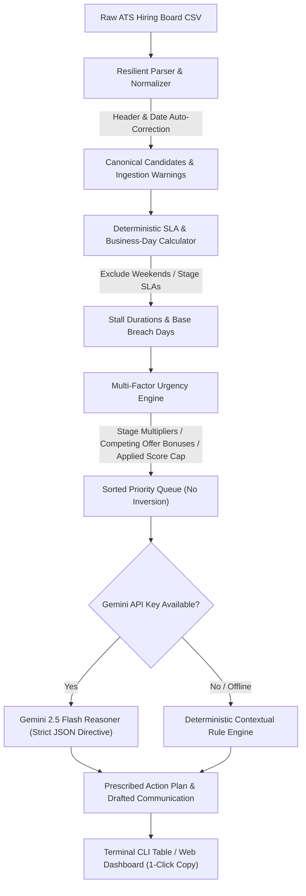

# ⚡ Hiring Board Stall Alerter (AI-First)

> **Format C:** Reads a CSV of a hiring board, finds candidates who have not moved for a set number of days, and lists who to follow up first and what to do.

[](https://nodejs.org/)
[](https://www.typescriptlang.org/)
[](https://vitest.dev/)
[]()

---

## 📖 Overview
In modern talent operations, hiring pipelines grind to a halt not because candidates fail interviews, but because candidates get stuck in limbo—waiting for an interviewer to submit a scorecard, a manager to approve leveling, or a recruiter to send an offer.

The **Stall Alerter** is an AI-first decision engine designed to solve this. It ingests messy ATS exports, eliminates priority inversion, identifies who owns the blocker, and drafts ready-to-send messages for immediate action.

---

## 🚀 Quickstart

### 1. Prerequisites & Installation
Ensure you have Node.js (v18+) installed. Clone the repository and install dependencies:

```bash
npm install
```

### 2. Run the Interactive CLI
Evaluate any hiring board CSV directly in your terminal:

```bash
# Analyze the baseline clean board
npm run cli -- analyze data/clean_board.csv -r 2026-03-25

# Deep-dive into a specific candidate and view ready-to-send draft communications
npm run cli -- inspect CAND-101 data/clean_board.csv -r 2026-03-25

# Run the automated load & stress test across all 3 datasets
npm run stress-test
```

### 3. Launch the Web Review Dashboard
Prefer a graphical web dashboard? Launch the local server:

```bash
npm run web
```
Then open **[http://localhost:3000](http://localhost:3000)** in your browser.

- 📊 Toggle between **Clean Baseline**, **Messy Real-World**, and **Adversarial** datasets with one click.
- 📁 Drag-and-drop your own hiring board CSV.
- 🎛️ Adjust SLA thresholds, filter by stage, urgency, or department in real time.
- 📋 Click **"View Draft"** to inspect candidate dossiers and copy ready-to-send email/Slack messages with one click.

### 4. Run the Test Suite
Run the 14 automated unit and integration tests:

```bash
npm test
```

---

## 🤖 AI Configuration (Online vs Offline)

The application features a **Dual-Engine Architecture**:
1. **Google Gemini API Engine:** If you have a Google Gemini API key, configure it in `.env` (or pass it in your environment):
   ```bash
   GEMINI_API_KEY="your-gemini-api-key"
   GEMINI_MODEL="gemini-2.5-flash"  # Optional, defaults to gemini-2.5-flash
   ```
   Run with `--ai`:
   ```bash
   npm run cli -- analyze data/clean_board.csv -r 2026-03-25 --ai
   ```
2. **Deterministic Contextual Engine (Zero-Downtime Fallback):** If no API key is provided or if network calls are offline, the system seamlessly uses its local contextual rules engine. It produces identical structured schemas without crashing, requiring no external dependencies.

---

## 🏗️ Architecture: The Hybrid Cognitive Pipeline



---

## 📁 Included Datasets

- **`data/clean_board.csv`**: Baseline dataset with 12 candidates across standard pipeline stages (`Applied`, `Screening`, `Take-Home`, `Technical Interview`, `Onsite`, `Debrief`, `Offer Discussion`, `Offer Extended`).
- **`data/messy_board.csv`**: Real-world chaos testing: inconsistent headers (`applicant_name`, `Job Title`, `Last Updated`), non-standard dates (`03/14/2026`, `2026/03/10`, `N/A`), and unassigned next step owners.
- **`data/adversarial_board.csv`**: High-load stress testing: 15 complex candidates with competing offer deadlines, split debrief loops, unresponsive candidates, and visa dependencies.

---

## 📋 CLI Reference

```bash
stall-alert analyze <csvPath> [options]
  -d, --days <threshold>           Custom stall threshold in days (overrides stage SLAs)
  -s, --stage <stage>              Filter by pipeline stage (e.g., "Offer Extended", "Debrief")
  --dept, --department <dept>      Filter by department (e.g., "Core Platform")
  -u, --urgency <level>            Filter by urgency ("CRITICAL", "HIGH", "MEDIUM", "LOW")
  -r, --reference-date <YYYY-MM-DD> Set evaluation reference date (default: today)
  --json                           Output raw JSON to stdout
  --export <filePath>              Export summary report to a JSON file
  --ai                             Enable Gemini LLM synthesis

stall-alert inspect <candidateId> <csvPath> [options]
  -r, --reference-date <YYYY-MM-DD> Set evaluation reference date
  --ai                             Use Gemini LLM synthesis

stall-alert stress-test
  Runs automated benchmark across all three datasets and outputs performance metrics
```

---

## 📦 Project Deliverables Checklist

- [x] **Working Code:** Full TypeScript implementation (`src/parser/`, `src/analyzer/`, `src/ai/`, `src/cli/`, `src/web/`).
- [x] **Automated Tests:** 14 Vitest unit & integration tests (`npm test`).
- [x] **`intent.md`**: Initial problem framing, hypothesis, and AI-first philosophy.
- [x] **`directive.md`**: Operational system directives, strict JSON schemas, and edge case rubric.
- [x] **`unlearning.md`**: 1-page note on the 5 legacy habits dropped during the sprint.
- [x] **Daily Logs:** `logs/day1.md` through `logs/day5.md` + unified `dev-log.md`.
- [x] **`LOOM_WALKTHROUGH.md`**: 5-minute video walkthrough guide, setup steps, and speaking script.
